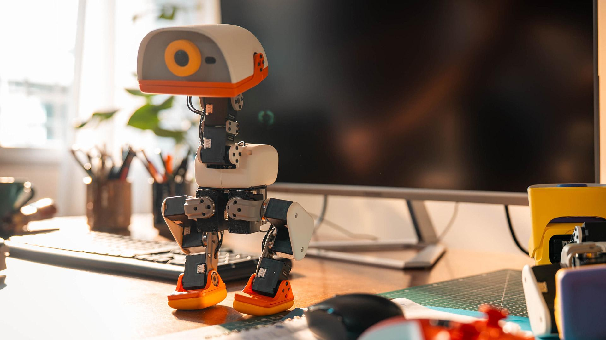

# 🦆 ML3576 Duck

**English** | [简体中文](README.zh-CN.md)

<p align="center">
  
</p>

**Open-source SDK & hardware interface docs for the ML3576-powered biped robot duck.**

[](LICENSE)
[](https://www.intelbaby.top)

> A desktop-sized biped robot duck powered by the **ML3576** AI compute board
> (RK3576, 6 TOPS NPU, Debian + ROS 2 Humble), with reinforcement-learning locomotion.
> Compatible with the open Microduck software ecosystem.

---

## 📌 Open Source Scope

| Content | Status | License |
|---|---|---|
| Upper-layer SDK, examples, docs | ✅ Open source | Apache-2.0 |
| Hardware interface specs (pinout, servo protocol) | ✅ Open source | Apache-2.0/CC-BY-4.0 |
| Structural design (CAD), PCB, BOM | ❌ Proprietary | Contact us for licensing |

> Only the upper-layer SDK, examples and hardware interface docs are open-sourced.
> Structural design, PCB and BOM are proprietary — contact us for commercial licensing.

## ✨ Features

- 🧠 **ML3576** core board: RK3576 SoC, 6 TOPS NPU, 4/8GB LPDDR4
- 🦵 15-DOF bipedal locomotion, RL-trained policies
- 🤖 Debian 11 + ROS 2 Humble onboard
- 🔌 Documented hardware interface for secondary development
- 🌏 Chinese & English documentation

## 🦆 MLDuck Product Overview

### 🚶 Core Behaviors

- Walking, standing up, bending forward and other basic motions, with emotional feedback
- Extended moves such as ball kicking and rolling
- Advanced skills such as roller skating and carrying objects
- Bluetooth remote control
- Firmware OTA updates

### 🧠 On-Device AI (6 TOPS NPU + Voice Module)

- AI pairing over Wi-Fi / Bluetooth
- Offline voice wake-up
- Offline voice commands
- Autonomous cruising
- Edge detection

📖 [Full offline voice command list](docs/voice-commands.md) — 70+ built-in wake words and commands.

### ☁️ Intelbaby Robot Cloud Services

*Available in China; coming soon to other regions.*

- Remote video streaming
- Remote control
- General-purpose visual detection
- Online voice interaction

### 💾 Firmware & System

- Linux + Android dual system
- TV casting and Android entertainment apps
- Wireless display
- HDMI 4K output

## 🚀 Quick Start

*Coming soon — SDK v0.1.0 is in preparation.*

```bash
# Example (will be updated upon release)
pip install ml3576-duck-sdk
```