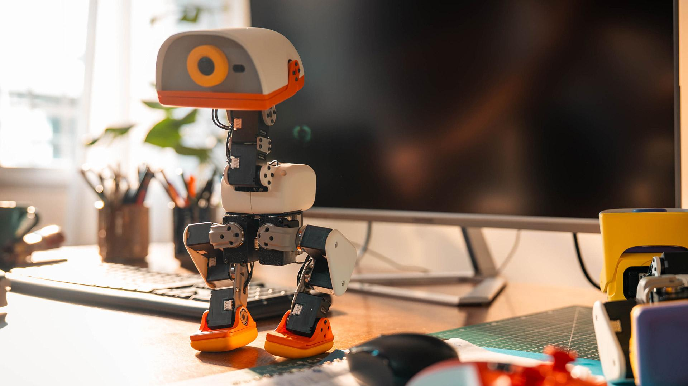

# 🦆 ML3576 Duck

[English](README.md) | **简体中文**

<p align="center">
  
</p>

**基于 ML3576 的双足机器鸭 · 开源 SDK 与硬件接口文档**

[](LICENSE)
[](https://www.intelbaby.top)

> 一只由 **ML3576** AI 算力板驱动的桌面级双足机器鸭，支持强化学习步态，
> 兼容 Microduck 开源软件生态。

---

## 📌 开源范围

| 内容 | 状态 | 许可 |
|---|---|---|
| 上层 SDK、示例与文档 | ✅ 开源 | Apache-2.0 |
| 硬件接口规格（引脚定义、舵机协议） | ✅ 开源 | Apache-2.0/CC-BY-4.0 |
| 结构设计（CAD）、PCB 与 BOM | ❌ 专有 | 商业授权请联系我们 |

> 本仓库仅开源上层 SDK、示例与硬件接口文档；结构设计、PCB 与物料清单为专有技术，
> 商业合作请联系我们。

## ✨ 特性

- 🧠 **ML3576** 核心板：RK3576 SoC，6 TOPS NPU，4/8GB LPDDR4
- 🦵 15 自由度双足步态，强化学习策略
- 🤖 板载 Debian 11 + ROS 2 Humble
- 🔌 完整硬件接口文档，支持二次开发
- 🌏 中英文双语文档

## 🦆 MLDuck 产品概览

### 🚶 基础动作与交互

- 走路、站起、俯身等基础动作行为与情绪反馈
- 踢球、翻滚等扩展动作
- 轮滑、叼东西等复杂技能
- 蓝牙遥控
- 固件 OTA 升级

### 🧠 端侧 AI（内置 6 TOPS NPU）

- Wi-Fi / 蓝牙 AI 配对
- 离线语音唤醒
- 离线语音指令
- 自动巡航
- 边缘检测

### ☁️ Intelbaby 机器人云服务

- 远程视频推流
- 远程遥控
- 泛视觉检测
- 在线语音交互

### 💾 固件与系统

- Linux + Android 双系统
- 电视投屏与 Android 娱乐应用

## 🚀 快速开始

*SDK 正在准备中，即将发布。*

```bash
# 示例（发布后将更新）
pip install ml3576-duck-sdk
```